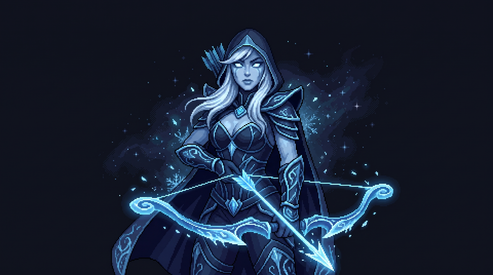

  <h1>Hi there, I'm Edris Ahani 👋</h1>
  <h3>Backend-focused Software Engineer | Full-Stack Thinker</h3>
  
  

    Passionate about building reliable software, solving hard problems, and leveling up my skills.  
    I love building the core logic behind the scenes, with enough frontend experience to ensure everything connects seamlessly.
  

  
  📫 **How to reach me:** [Email Me](mailto:edris.ahani.tutorial@gmail.com) | [LinkedIn](https://www.linkedin.com/in/edris-ahani/)

---

## 💻 Tech Stack & Tools

*Here are some of the key technologies I've worked with (though my experience extends to various other tools and frameworks as well):*

*   **Backend & Frameworks:** Java, Spring Boot, Node.js, NestJS, C#, .NET Core
*   **Frontend & Mobile:** Next.js, Android (Kotlin)
*   **Databases & Caching:** PostgreSQL, MySQL, MongoDB, Redis
*   **Message Brokers & IoT:** RabbitMQ, ThingsBoard
*   **DevOps & Infrastructure:** Linux, Docker, Docker Compose, Nginx, Coolify, Server Configuration
*   **Monitoring & Observability:** Grafana, Loki
*   **Other Tech:** WebRTC

---

## 📊 GitHub Analytics

  
  

---

## 🎯 Meet My Git Guardian

<table align="center" style="border: none;">
  <tr>
    <td align="center" width="350">
      
    </td>
    <td width="550" style="vertical-align: middle; padding-left: 20px;">
      <h2>Traxex, The Frost Guardian ❄️</h2>
      
<i>"I walk alone, but the shadows and code are company enough."</i>

      

      <ul>
        <li>🏹 <b>Role:</b> Repository Overwatch</li>
        <li>⚔️ <b>Power Source:</b> She grows stronger with every real commit in my GitHub!</li>
        <li>🛡️ <b>Duty:</b> Watching over the codebase and keeping the streak alive.</li>
      </ul>
       
      
My stats above fuel her arrows. As long as I code, the repository remains safe!

    </td>
  </tr>
</table>
